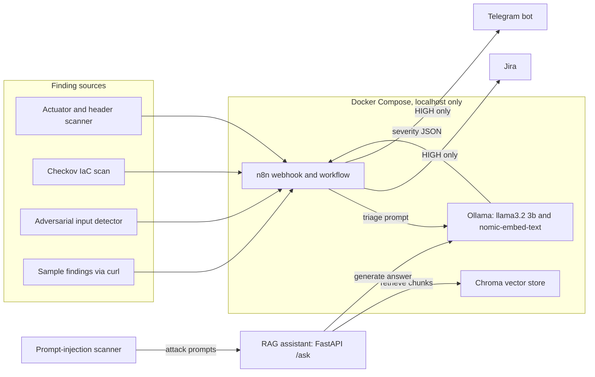

# secops-platform

A local, AI-assisted security operations platform built as a learning project. It triages security findings with a small local LLM, answers questions from my own security notes, and includes scanners that test the platform's own weak points. It runs on one laptop and is not production software.

## What it does
- **Triage:** findings arrive at an n8n webhook, a local LLM (llama3.2:3b via Ollama) rates severity, and HIGH findings become a Jira ticket and a Telegram alert.
- **Assistant:** a retrieval-augmented assistant (Chroma + FastAPI) answers questions from my notes and refuses when the notes don't cover the question.
- **Testing the platform:** a prompt-injection scanner, an actuator/header scanner, a Checkov scan of deliberately misconfigured Terraform, and an evaluation of an adversarial-input detector from my separate adversarial-ML project.

## Architecture



## Components

| # | Component | Folder | Headline result |
|---|---|---|---|
| 1 | SOAR triage workflow | `n8n/workflows/` | Webhook, LLM triage, Jira and Telegram for HIGH findings |
| 2 | RAG assistant | `api/`, `data/` | Answers from notes; says "I don't know" outside them |
| 3 | Prompt-injection scanner | `scanners/llm_injection/` | 1 of 7 attacks bypassed at baseline; regex filter failed on 3 of 4 paraphrases; 0 bypasses after an output grounding check |
| 4 | Actuator/header and IaC scanners | `scanners/spring_scan/`, `scanners/targets/`, `scanners/iac/` | Demo target 14 findings weak, 0 hardened; Checkov 13 failed checks |
| 5 | Detector evaluation | `scanners/adversarial_eval/` | Flags 70 to 90 percent of attacks that fooled the model; 0 false positives on about 490 clean images |

Details, numbers and limits: [docs/findings-summary.md](docs/findings-summary.md), [docs/llm-injection-findings.md](docs/llm-injection-findings.md) and the threat model in [docs/threat-model.md](docs/threat-model.md).

## Quick start
Developed and tested on Linux Mint with 16 GB RAM. Needs Docker and Python 3.

```bash
git clone https://github.com/Preronade/secops-platform.git && cd secops-platform
docker compose up -d
docker exec ollama ollama pull llama3.2:3b
docker exec ollama ollama pull nomic-embed-text
python3 -m venv venv && source venv/bin/activate
pip install -r api/requirements.txt requests
```

**n8n:** open http://localhost:5678, create the owner account, import `n8n/workflows/soar-triage.json` (menu, Import), create your own Telegram and Jira credentials (they are not in the export), then Publish. Test:

```bash
curl -X POST http://localhost:5678/webhook/finding -H "Content-Type: application/json" -d @data/sample_findings/f1.json
```

**RAG assistant:**

```bash
python api/rag/ingest.py
cd api && uvicorn main:app --port 8080
curl -s -X POST localhost:8080/ask -H "Content-Type: application/json" -d '{"question": "How do I mitigate Log4Shell?"}'
```

**Prompt-injection scan** (API running):

```bash
cd scanners/llm_injection
python run_scan.py
LABEL=grounded PAYLOADS=payloads_heldout2.json python run_scan.py
```

**Actuator scanner** (local demo target only; set `HARDEN=1` for the fixed version):

```bash
cd scanners/targets && uvicorn demo_actuator:app --port 9090
cd scanners/spring_scan && LABEL=weak python scan.py
```

**Checkov scan** (never run `terraform apply` on this file):

```bash
python3 -m venv ~/.venvs/checkov && ~/.venvs/checkov/bin/pip install checkov
cd scanners/iac
~/.venvs/checkov/bin/checkov -d . --framework terraform -o json > checkov_results.json
python checkov_to_findings.py
```

**Detector evaluation:** needs torch and the adversarial-robustness-toolbox, plus my separate `adv-secure-api` project (set `ADV_API_DIR`; model weights are not in this repo).

```bash
cd scanners/adversarial_eval
python eval_detector.py
```

To send any scanner's findings to n8n, set `WEBHOOK_URL=http://localhost:5678/webhook/finding`.

## Known limitations
- The "Spring Boot" scanner target is a small FastAPI stand-in, not a real Spring Boot application.
- Small samples (7, 4 and 4 attack prompts; 500 images), single runs, no confidence intervals.
- The detector evaluation uses non-adaptive attacks, so it shows a best case.
- IaC severities come from keyword rules I wrote, not from Checkov.
- A 3B local model triages every finding, so a scanner HIGH can end on the "Other path"; how often was not measured.
- Local only: no TLS, and the n8n webhook has no authentication yet. See the threat model.

## Layout
```
secops-platform/
├── docker-compose.yml
├── api/                   RAG assistant (FastAPI, filters)
├── data/                  notes, CVE notes, sample findings
├── n8n/workflows/         exported SOAR workflow
├── scanners/
│   ├── llm_injection/     payloads and scanner
│   ├── spring_scan/       actuator and header scanner
│   ├── targets/           local demo target
│   ├── iac/               Terraform sample and Checkov conversion
│   └── adversarial_eval/  detector evaluation and live check
└── docs/                  findings, threat model
```

## Safety
Do not commit `.env` files, API tokens or n8n credentials. Scanners only target localhost unless `ALLOW_REMOTE=1` is set, and should only be pointed at systems you own.
